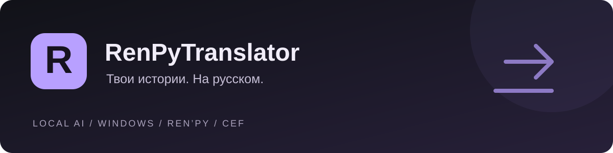

<div align="center">



# RenPyTranslator — переводчик игр Ren’Py

**Перевод визуальных новелл на русский язык с локальным ИИ.**

[](https://github.com/UFrimNe/RenPyTranslator/actions/workflows/release.yml)
[](https://github.com/UFrimNe/RenPyTranslator/releases/latest)
[](docs/USER_GUIDE.md)
[](#проверка-на-вирусы)

[**Скачать программу**](https://github.com/UFrimNe/RenPyTranslator/releases/latest) · [Как пользоваться](docs/USER_GUIDE.md) · [Собрать самому](docs/BUILD_WINDOWS.md) · [Сообщить о проблеме](https://github.com/UFrimNe/RenPyTranslator/issues)

</div>

## Скачать и начать

| Что скачать | Для чего |
| --- | --- |
| [**Установщик EXE**](https://github.com/UFrimNe/RenPyTranslator/releases/latest/download/RenPyTranslator_11.29_Setup_win64.exe) | Установить полную программу и создать ярлык. Python и .NET уже в комплекте. |
| [**Portable ZIP**](https://github.com/UFrimNe/RenPyTranslator/releases/latest/download/RenPyTranslator_11_29_win64.zip) | Распаковать в удобную папку и открыть **RPTS.exe**. Установка не требуется. |
| [**Исходники ZIP**](https://github.com/UFrimNe/RenPyTranslator/releases/latest/download/RenPyTranslator_11_29_source.zip) | Изучить код, изменить программу или собрать свою копию через **Build.bat**. |

1. Открой программу через ярлык или `RPTS.exe`.
2. Добавь папку игры и выбери локальную модель. При первом запуске загрузятся модель и движок.
3. Начни перевод. Готовую часть можно установить и запустить игру, затем продолжить перевод позже.

**API-ключ для локального перевода не нужен.** После загрузки модели перевод работает без интернета.
Проверка и скачивание обновлений требуют подключения; ошибка проверки не мешает переводу.

> Обновление с 11.27: закрой программу и один раз распакуй новый полный ZIP в прежнюю папку с заменой файлов. Папки `data` и `runtime/local_ai` сохраняй. Старые технические теги удалены; следующие обновления доступны из нового лаунчера.

## Проверка на вирусы

Для файлов **релиза v11.28** добавлены ссылки на поиск отчётов VirusTotal по SHA-256:

| Файл | VirusTotal |
| --- | --- |
| Установщик EXE | [Найти отчёт](https://www.virustotal.com/gui/file/8786d57989d6550cb67c354c2ea479c4b38d3960613af864335e719b1ed31727) |
| Portable ZIP | [Найти отчёт](https://www.virustotal.com/gui/file/23a52e483f4e42076a7b245c76a6eb733c972b1c15ead603d2ff270b9a2ab869) |

Если отчёт не найден, [открой VirusTotal](https://www.virustotal.com/gui/home/upload) и выбери скачанный EXE или ZIP для анализа. Отчёт относится к конкретному файлу с указанным хешем.

<details>
<summary><strong>Сверить контрольные суммы</strong></summary>

**RenPyTranslator_11.28_Setup_win64.exe**

```text
8786d57989d6550cb67c354c2ea479c4b38d3960613af864335e719b1ed31727
```

**RenPyTranslator_11_28_win64.zip**

```text
23a52e483f4e42076a7b245c76a6eb733c972b1c15ead603d2ff270b9a2ab869
```

[Все контрольные суммы релиза v11.28](https://github.com/UFrimNe/RenPyTranslator/releases/download/v11.28/SHA256SUMS.txt).

В PowerShell можно получить SHA-256 скачанного установщика:

```powershell
(Get-FileHash ".\RenPyTranslator_11.28_Setup_win64.exe" -Algorithm SHA256).Hash
```

SHA-256 помогает сверить скачанный файл с опубликованным релизом; антивирусную проверку выполняет VirusTotal.

</details>

## Что умеет программа

- Карточки игр, выбранная модель, прогресс задач и библиотека готовых переводов.
- Локальный ИИ через llama.cpp: несколько моделей и настройки под их формат.
- Контекст сцены, сведения о персонажах и автоматические проверки рода, разметки и идентификаторов.
- Извлечение диалогов, телефона и интерфейса из файлов игры; захват в игре — запасной способ.
- Сборка, установка и запуск готового перевода, включая частично переведённую игру.
- Обновление из версионных GitHub Releases с проверкой SHA-256, резервной копией и откатом.
- Один диагностический ZIP с журналами, состоянием проекта и запросами ИИ.

Качество зависит от модели и исходного текста. Для проверки стиля удобно сначала перевести короткую сцену.

## Запуск и хранение

| Файл / папка | Назначение |
| --- | --- |
| `RPTS.exe` | Обычный графический запуск без консоли |
| `RPTS.bat` / `RPTS.vbs` | Альтернативный графический запуск |
| `RPTS-Console.bat` | Расширенное консольное меню |
| `RPTS-Debug.bat` | Диагностика запуска, если окно не открылось |
| `data` | Настройки, проекты, готовые переводы и диагностические ZIP |
| `runtime/local_ai` | Скачанные модели и llama.cpp |

Игры остаются в своих папках. Установщик и автообновление не включают пользовательские базы, настройки или модели в поставку.
`RPTS.exe` в portable-версии нужно оставлять рядом с `app` и `runtime`. Для распространения одним файлом предназначен установщик EXE.

## Сборка из исходников

На Windows установи Python 3.11+, .NET 8 SDK, Visual Studio Build Tools с компонентом
**Desktop development with C++** и Inno Setup 6. Затем открой **Build.bat** в корне исходников.
Готовые EXE, полный ZIP, исходники и контрольные суммы появятся в `dist`.

```bat
Build.bat
```

Без установщика: `Build.bat -NoInstaller`. Для повторной сборки с уже подготовленными средами: `Build.bat -SkipRuntime`.
[Пошаговая инструкция и требования](docs/BUILD_WINDOWS.md).

<details>
<summary><strong>Разработчикам: код, проверки и выпуск</strong></summary>

- `main` — рабочая и публичная ветка.
- `app/src/rpts` — извлечение, перевод, проверки и базы.
- `app/tools` — CLI, сервер, сборка и упаковка.
- `app/web` — интерфейс CEF; `app/desktop` — C#-контейнер.
- `app/launcher` — исходник корневого EXE; `app/installer` — исходник установщика.

```sh
python app/tools/check_source.py
```

Windows CI проверяет исходники и интерфейс, собирает все файлы и проверяет установку/удаление.
Публикация выполняется из `main` с тегом `v<версия>`. Готовый релиз повторно не перезаписывается.
Для нового релиза меняются `app/VERSION.txt` и заметки в `docs/releases`.
Сейчас используется только `main`; дополнительная ветка разработки временно убрана.

[Разработка](docs/DEVELOPMENT.md) · [Устройство обновлений](docs/UPDATES.md) · [Изменения 11.29](docs/CHANGELOG_11_29.md)

</details>

## Если возникла ошибка

В меню **Помощь и диагностика** собери ZIP и приложи его к [issue](https://github.com/UFrimNe/RenPyTranslator/issues).
Если окно не открывается — запусти `RPTS-Debug.bat`. В отчёте может быть текст игры и перевода; API-ключи скрываются.

## Благодарности

В RPTS используются сторонние проекты, модели и инструменты. Спасибо их авторам и сообществам за работу, на которую опирается программа.

| Проект | Авторы и команды | Роль в RPTS |
| --- | --- | --- |
| [llama.cpp](https://github.com/ggml-org/llama.cpp) / [ggml](https://github.com/ggml-org/ggml) | Georgi Gerganov, ggml-org и участники проектов | Локальный запуск GGUF-моделей и сервер перевода. |
| [unrpyc](https://github.com/CensoredUsername/unrpyc) | Yuri K. Schlesner, CensoredUsername, Jackmcbarn и участники проекта | Чтение и декомпиляция скомпилированных скриптов Ren’Py `.rpyc`. |
| [Ren’Py](https://github.com/renpy/renpy) | Tom Rothamel и сообщество Ren’Py | Движок, форматы скриптов, система локализации и документация, с которыми работает переводчик. |
| [CEF](https://github.com/chromiumembedded/cef) / [Chromium](https://www.chromium.org/) | Команды Chromium Embedded Framework и Chromium | Браузерный движок графического интерфейса. |
| [CefSharp](https://github.com/cefsharp/CefSharp) | Авторы и участники CefSharp | Интеграция CEF с оконным контейнером на C#. |
| [SQLite](https://www.sqlite.org/) | Richard Hipp и команда SQLite | Базы проектов, строки перевода и история обработки. |
| [Qwen](https://huggingface.co/Qwen) | Qwen Team | Поддерживаемые модели Qwen3 и Qwen3.5. |
| [Hy-MT2](https://huggingface.co/tencent/Hy-MT2-7B-GGUF) | Tencent Hunyuan | Специализированные модели перевода. |
| [TranslateGemma](https://huggingface.co/google/translategemma-12b-it) | Google | Переводческая модель, доступная в экспериментальном режиме. |
| [DeepSeek-R1](https://github.com/deepseek-ai/DeepSeek-R1) | DeepSeek-AI | Экспериментальная модель DeepSeek-R1-Distill-Qwen. |
| GGUF-сборки моделей | [Unsloth](https://huggingface.co/unsloth), [ggml-org](https://huggingface.co/ggml-org), [NikolayKozloff](https://huggingface.co/NikolayKozloff/translategemma-12b-it-Q4_K_M-GGUF), а также команды Qwen и Tencent | Подготовка и публикация GGUF-файлов, используемых каталогом моделей RPTS. |
| [Hugging Face](https://huggingface.co/) | Команда Hugging Face и авторы репозиториев моделей | Размещение моделей и их карточек, загрузка файлов. |
| [Python / CPython](https://www.python.org/) | Python Software Foundation и сообщество Python | Ядро переводчика, извлечение текста и диагностика. |
| [.NET](https://dotnet.microsoft.com/) / [Visual C++](https://visualstudio.microsoft.com/vs/features/cplusplus/) | Microsoft и участники .NET | Оконный контейнер, стандартный выбор папки и сборка Windows-компонентов. |
| [Inno Setup](https://jrsoftware.org/isinfo.php) | Jordan Russell и Martijn Laan | Сборка полного установщика EXE. |
| [Flaticon Uicons](https://www.flaticon.com/uicons) | Flaticon | Иконки интерфейса. |

Движок llama.cpp, модели и unrpyc загружаются отдельно при необходимости. Сведения о сторонних компонентах и их лицензиях собраны в [THIRD_PARTY.md](app/THIRD_PARTY.md).

Атрибуция иконок: [Flaticon Uicons](app/FLATICON-LICENSE.txt). Сторонние компоненты: [THIRD_PARTY.md](app/THIRD_PARTY.md).
